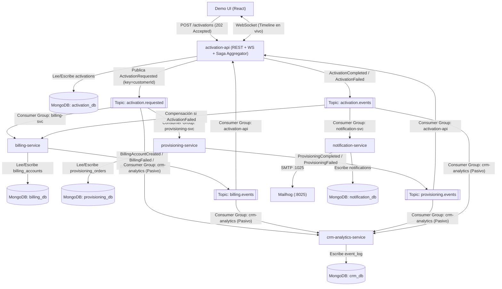

# Plan de Implementación y Bitácora Viva — POC Activación de Servicios con Kafka

> **Materia:** Sistemas Distribuidos (4° Año - UTN FRCU)  
> **Stack:** NestJS · Apache Kafka (KRaft) · MongoDB (Replica Set) · Socket.IO · Mailhog · pnpm Workspaces  
> **Timebox:** 2.5 horas (Foco en Backend: Fases 1 y 2 completas + base lista para Fase 3)

---

## 1. Visión General de la Arquitectura

La POC implementa una **Saga Coreografiada con Agregador** orientada a eventos sobre Apache Kafka, donde ningún microservicio se comunica por HTTP con otro:

### Componentes del Monorepo
| Componente | Tipo | Puerto Host | Base de Datos MongoDB | Rol en la Saga |
| :--- | :--- | :---: | :--- | :--- |
| `libs/contracts` | Librería TS | — | — | Fuente única de verdad: `EventEnvelope`, `KAFKA_TOPICS`, `EVENT_TYPES`, `CONSUMER_GROUPS`, Payloads. |
| `apps/activation-api` | NestJS App | `3000` | `activation_db` (`activations`) | API REST (`POST /activations`, `GET /activations/:id`), Agregador de la Saga y Gateway WebSocket (`Socket.IO`). |
| `apps/billing-service` | NestJS Worker | `3001` | `billing_db` (`billing_accounts`) | Crea cuenta de facturación y ejecuta **compensación** (`CANCELLED`) ante `ActivationFailed`. |
| `apps/provisioning-service` | NestJS Worker | `3002` | `provisioning_db` (`provisioning_orders`) | Simula aprovisionamiento técnico con delay de 1–3 s y soporte de fallo inyectado. |
| `apps/notification-service` | NestJS Worker | `3003` | `notification_db` (`notifications`) | Envía emails de bienvenida o error vía SMTP a Mailhog al cierre de la Saga. |
| `apps/crm-analytics-service` | NestJS Worker | `3004` | `crm_db` (`event_log`) | Consumidor pasivo universal para auditoría de punta a punta y replay histórico. |

### Tópicos de Kafka (3 particiones, retención 7 días, clave = `customerId`)
1. `activation.requested` (+ `activation.requested.dlq`)
2. `billing.events` (+ `billing.events.dlq`)
3. `provisioning.events` (+ `provisioning.events.dlq`)
4. `activation.events` (+ `activation.events.dlq`)

---

## 2. Desglose Secuencial de Tareas (Roadmap Fases 1 y 2)

### Etapa 0: Infraestructura Base y Contratos (`feat/phase1-infra-contracts`)
- [x] **Paso 0.1:** Crear `plan.md` con arquitectura, roadmap y bitácora viva.
- [x] **Paso 0.2:** Configurar `docker-compose.yml` con:
  - `kafka` (Apache Kafka en modo KRaft sin ZooKeeper, doble listener `localhost:9092` para host y `kafka:29092` para red interna Docker).
  - `kafka-init` + `docker/create-topics.sh` (creación automática de los 4 tópicos de negocio + 4 tópicos `.dlq` con 3 particiones y retención 7 días).
  - `mongo` (MongoDB 7 en modo Replica Set de 1 nodo `rs0` en puerto `27017` con auto-inicialización).
  - `kafka-ui` (Kafbat UI en puerto `8080`).
  - `mailhog` (Servidor SMTP en `1025` e interfaz web en `8025`).
- [x] **Paso 0.3:** Inicializar el monorepo con `pnpm-workspace.yaml`, `package.json` raíz, `tsconfig.base.json` y `.env.example`.
- [x] **Paso 0.4:** Implementar `libs/contracts` con el sobre estándar `EventEnvelope<T>`, constructores de eventos, tipos de estado (`PENDING`, `IN_PROGRESS`, `ACTIVE`, `FAILED`), modos de fallo (`none`, `billing`, `provisioning`), nombres de tópicos y grupos de consumidores.
- [ ] **Punto de Control Git #1:** Validar `docker compose up -d` y hacer commit en rama `feat/phase1-infra-contracts`.

---

### Fase 1: Camino Feliz en Consola (`feat/phase1-core-saga`)
**Objetivo:** Cumplir **RF-01 a RF-05**, **RNF-01**, **RNF-02**, **RNF-07**. Verificar el flujo completo del camino feliz por consola y Kafka UI.

- [ ] **Paso 1.1 — `apps/activation-api` (Base + Agregador Camino Feliz):**
  - Esquema Mongoose `Activation` (`_id = activationId`, `customerId`, `planId`, `channel`, `status`, `simulateFailure`, `steps: { billing, provisioning }`, `history`).
  - `POST /activations`: guarda documento en estado `PENDING`, registra `ActivationRequested` en `history`, publica en `activation.requested` usando `customerId` como clave de partición y responde inmediatamente `HTTP 202 Accepted` con `{ activationId, status: 'PENDING' }`.
  - Consumidores `@EventPattern('billing.events')` y `@EventPattern('provisioning.events')`:
    - Actualizan el paso correspondiente (`steps.billing` o `steps.provisioning`) y anexan el evento a `history`.
    - Si es el primer resultado recibido y el estado es `PENDING`, transiciona a `IN_PROGRESS`.
    - Si ambos pasos están en `OK`, transiciona a `ACTIVE` y publica `ActivationCompleted` en `activation.events` (con clave `customerId`).
- [ ] **Paso 1.2 — `apps/billing-service` (Creación de Cuenta):**
  - Esquema Mongoose `BillingAccount` (`activationId` único, `customerId`, `planId`, `status: 'CREATED' | 'CANCELLED'`).
  - Consumidor `@EventPattern('activation.requested')` con grupo `billing-svc`:
    - Si `simulateFailure === 'none'` (o distinto de `'billing'`), crea la cuenta con estado `CREATED` y publica `BillingAccountCreated` en `billing.events`.
- [ ] **Paso 1.3 — `apps/provisioning-service` (Aprovisionamiento con Retardo):**
  - Esquema Mongoose `ProvisioningOrder` (`activationId` único, `customerId`, `planId`, `status: 'COMPLETED' | 'FAILED'`).
  - Consumidor `@EventPattern('activation.requested')` con grupo `provisioning-svc`:
    - Aplica retardo simulado de 1 a 3 segundos (`1000ms - 3000ms`).
    - Guarda orden en `provisioning_orders` y publica `ProvisioningCompleted` en `provisioning.events`.
- [ ] **Punto de Control Git #2:** Probar `POST /activations` con `simulateFailure: "none"`, verificar logs en paralelo y evento `ActivationCompleted` en Kafka UI. Commit en `feat/phase1-core-saga`.

---

### Fase 2: WebSockets, Inyección de Fallos, Compensación y Notificaciones (`feat/phase2-compensation-ws-notifications`)
**Objetivo:** Cumplir **RF-06 a RF-09** (y **RF-10** base con `crm-analytics-service`). Dejar listos los Escenarios 1 y 2 de punta a punta para conectar con el Front-end.

- [ ] **Paso 2.1 — Consulta y Tiempo Real en `apps/activation-api` (RF-08, RF-09):**
  - Endpoint `GET /activations/:id` que retorna el documento completo de la activación con su estado actual, `steps` y `history`.
  - `@WebSocketGateway({ cors: { origin: '*' } })` con Socket.IO que emite en vivo cada cambio de estado y evento (`activation.updated` / suscripción por `activationId` y broadcast general para la Demo UI).
- [ ] **Paso 2.2 — Inyección de Fallos y Coordinación de Fallos en Agregador (RF-06):**
  - En `billing-service`: si `simulateFailure === 'billing'`, publica `BillingFailed` en `billing.events`.
  - En `provisioning-service`: si `simulateFailure === 'provisioning'`, tras el delay de 1-3s guarda orden fallida y publica `ProvisioningFailed` en `provisioning.events`.
  - En `activation-api`: si recibe `BillingFailed` o `ProvisioningFailed`:
    - Si la activación no estaba ya en `FAILED`, pasa el estado a `FAILED` y publica inmediatamente `ActivationFailed` en `activation.events`.
    - Si llegan eventos posteriores para una activación ya `FAILED` (ej. `BillingAccountCreated` tardío o `BillingAccountCancelled`), solo los agrega a `history` y los notifica por WebSocket sin cambiar el estado `FAILED`.
- [ ] **Paso 2.3 — Compensación Saga en `apps/billing-service` + Caso Borde (RF-06):**
  - `billing-service` escucha `@EventPattern('activation.events')` en el grupo `billing-svc`.
  - Al recibir `ActivationFailed`:
    - Si la cuenta ya existe con estado `CREATED`, la actualiza a `CANCELLED` y publica `BillingAccountCancelled` en `billing.events`.
    - **Resolución del Caso Borde (Carrera asíncrona):** Si `ActivationFailed` llega *antes* de que `billing-service` procese `ActivationRequested`, registra un marcador/registro con estado `CANCELLED` para ese `activationId`. Cuando luego llegue `ActivationRequested`, detecta que la activación ya falló, evita dejar la cuenta activa y asegura la emisión de `BillingAccountCancelled`.
- [ ] **Paso 2.4 — `apps/notification-service` con Mailhog (RF-07):**
  - Consumidor `@EventPattern('activation.events')` en el grupo `notification-svc`.
  - Con `ActivationCompleted`: envía email HTML/texto de bienvenida vía `nodemailer` al SMTP de Mailhog (`localhost:1025`) y persiste en colección `notifications`.
  - Con `ActivationFailed`: envía email de notificación de fallo de activación a Mailhog y persiste en `notifications`.
- [ ] **Paso 2.5 — `apps/crm-analytics-service` (Auditoría Pasiva - RF-10):**
  - Se suscribe con el grupo `crm-analytics` a los 4 tópicos (`activation.requested`, `billing.events`, `provisioning.events`, `activation.events`).
  - Almacena cada sobre íntegro en la colección `event_log` (con índice único en `eventId` e índice en `correlationId`).
- [ ] **Punto de Control Git #3:** Validar Escenario 1 (Camino Feliz + Email Bienvenida + WS) y Escenario 2 (Fallo en Provisioning + Compensación `BillingAccountCancelled` + Email Error + WS). Commit en `feat/phase2-compensation-ws-notifications`.

---

## 3. Bitácora Viva de Ingeniería (Decisiones, Problemas y Soluciones)

### Registro #1 — Análisis Inicial y Diseño de Infraestructura Base
- **Estado:** ✅ Etapa 0 completada
- **Archivos Generados:**
  - `plan.md`, `.gitattributes`, `docker-compose.yml`, `docker/create-topics.sh`
  - `pnpm-workspace.yaml`, `package.json`, `tsconfig.base.json`, `tsconfig.json`, `.env.example`
  - `libs/contracts/package.json`, `libs/contracts/tsconfig.json`, `libs/contracts/src/{index,topics,events,payloads,envelope}.ts`
- **Decisiones Arquitectónicas Tomadas:**
  1. **Doble Listener en Kafka KRaft (`PLAINTEXT://localhost:9092` y `DOCKER://kafka:29092`):**
     - *Problema anticipado:* Si Kafka solo anuncia `kafka:9092`, cuando corramos los microservicios NestJS desde la terminal de Windows (`pnpm start:dev`) para iterar rápido, `kafkajs` fallará con `getaddrinfo ENOTFOUND kafka`. Por otro lado, `kafka-ui` y `kafka-init` corren dentro de la red de Docker y necesitan conectarse por nombre de servicio (`kafka:29092`).
     - *Solución:* Configuramos dos listeners en `docker-compose.yml`: `PLAINTEXT` expuesto en `localhost:9092` para desarrollo en host y `DOCKER` en `kafka:29092` para contenedores internos.
  2. **MongoDB Replica Set de 1 Nodo (`rs0`) compatible con Host y Docker:**
     - *Problema anticipado:* MongoDB requiere un Replica Set para transacciones, pero al ejecutar `rs.initiate()` dentro de Docker suele registrar el hostname interno del contenedor, causando que Mongoose en Windows falle al intentar descubrir la topología del Replica Set.
     - *Solución:* Inicializamos `rs0` con `host: 'localhost:27017'` mediante el healthcheck de `mongo` y utilizamos `directConnection=true` en las URIs de conexión (`mongodb://localhost:27017/<db>?replicaSet=rs0&directConnection=true`).
  3. **Protección contra finales de línea CRLF en Windows para `create-topics.sh`:**
     - *Problema anticipado:* En Windows, Git o los editores suelen convertir LF a CRLF (`\r\n`), haciendo que los scripts `.sh` montados en contenedores Linux fallen con `$\r: command not found`.
     - *Solución:* Agregamos `.gitattributes` forzando `eol=lf` en archivos `.sh` y ejecutamos el script en `kafka-init` sanitizando retornos de carro (`tr -d '\r'`) antes de pasarlo a `sh`.
  4. **Diseño de `libs/contracts` y Deserialización Defensiva (`parseEventEnvelope`):**
     - Se centralizan todos los nombres de tópicos (`KAFKA_TOPICS`), grupos de consumo (`CONSUMER_GROUPS`), tipos de eventos (`EVENT_TYPES`), estados de activación (`ACTIVATION_STATUS`) y funciones utilitarias (`createEventEnvelope`, `toKafkaMessage`, `parseEventEnvelope`) para asegurar que el particionado por `customerId` y la lectura de mensajes en `@EventPattern` sean uniformes en los 5 microservicios.
